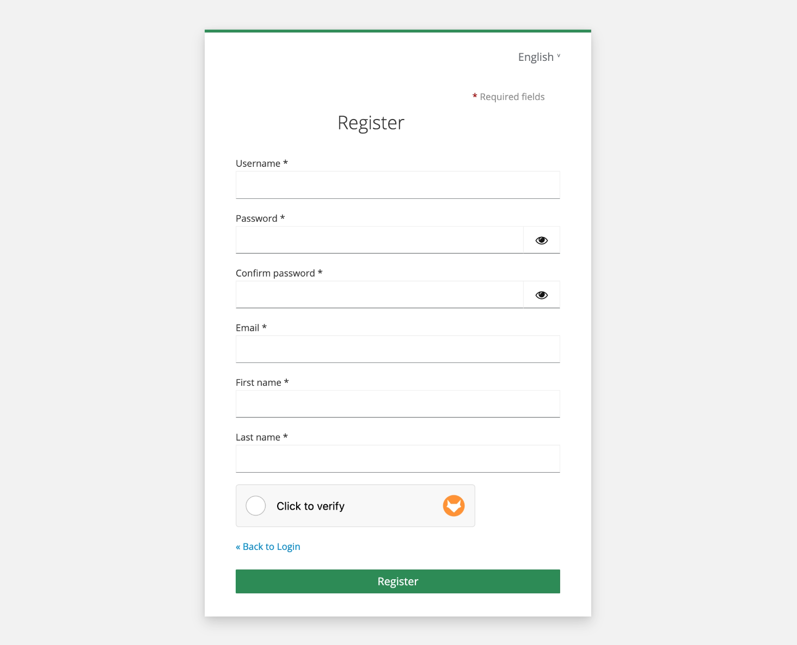

# CaptchaFox for Keycloak

This plugin adds support for the privacy-friendly bot protection provider CaptchaFox to Keycloak.



## Getting started

Visit our [documentation](https://docs.captchafox.com/integrations/keycloak) for a step-by-step guide on how to install and configure this plugin for your Keycloak instance.

## Available executions

| Execution                           | Type          | Use it in                                                                                            |
| ----------------------------------- | ------------- | ---------------------------------------------------------------------------------------------------- |
| `CaptchaFox`                        | Form action   | Form flows such as the Registration Form sub-flow. Requires the widget markup in the theme template. |
| `CaptchaFox Username Password Form` | Authenticator | Replaces the Username Password Form in the Browser flow. Requires the widget markup in `login.ftl`.  |
| `CaptchaFox Challenge`              | Authenticator | Any flow, e.g. Reset Credentials. Renders a captcha-only page, no theme changes required.            |

## Development

Compile it using Maven with Java 17:

```bash
mvn clean compile package
```

or execute the `build.sh` script.

Then copy the `keycloak-captchafox.jar` from the `target` directory to the `providers` folder in keycloak.

## Credits

Thanks to keycloak and p08dev for the original recaptcha implementation on which this is based on.
